<div align="center">

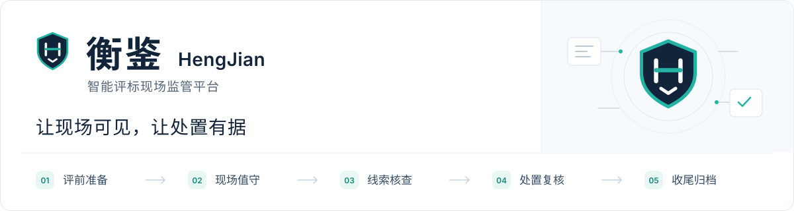

# 衡鉴 HengJian

### 智能评标现场监管平台

**看见异常，核查证据，跟进处置。**

面向评标现场的音视频监测与监管协作平台，让现场观察、人工核查、责任处置和证据归档在同一条工作流程中衔接。

[核心能力](#核心能力) · [工作流程](#从一场监管开始) · [开始使用](#开始使用) · [文档](#文档) · [反馈问题](https://github.com/fuyuxiang/ibess/issues)

</div>

---

评标现场的监管工作，需要的不只是一个视频画面或一条 AI 告警。衡鉴把项目、评标室、人员授权、评审阶段与现场证据关联起来，帮助监管人员发现线索、核查原片、安排处置并保留复核记录。

**机器提供线索，监管人员作出认定。** 行为预警和设备故障分别呈现；模型不可用、身份未核实或录像不完整时，如实显示受限状态与证据缺口。

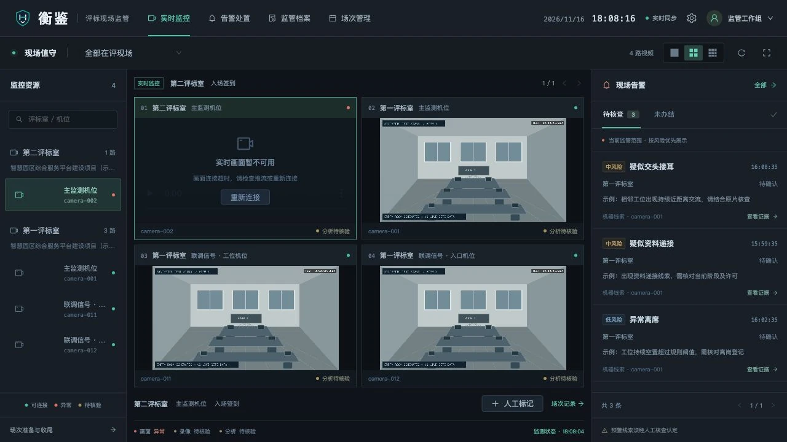

图中为合成空室信号与示例线索，展示真实页面交互，不代表现场识别效果。

## 核心能力

| 工作任务 | 衡鉴提供的能力 |
| --- | --- |
| 场次作业 | 评前检查、按方案推进阶段、巡查交接、现场结束与归档检查 |
| 现场值守 | 按项目、评标室和视频源查看现场，结合当前阶段掌握监测状态与待办 |
| 异常识别 | 连续画面分析、工位和区域规则、人员授权核验，以及语音转写和语义线索 |
| 证据核查 | 告警关联原始抓拍时间、关键帧、音视频记录及行为发生区间 |
| 处置协作 | 核查、认定、分派、反馈、复核、归档；保留责任人、期限及操作记录 |
| 证据留存 | 监管录像独立保全、摘要校验与鉴权回放，减少循环录像轮转对事件核查的影响 |
| 配置管理 | 统一管理项目、评标室、人员、授权、机位区域、阶段规则与岗位账号 |

### 面向评标现场的识别规则

- **人员交流与走动**：疑似交头接耳、串岗、资料递接、空间聚集和限制区域越界。
- **工位与离席**：连续离席、频繁离席、多人同时离席，并结合已登记的离岗许可排除正常活动。
- **手机与资料**：手机携带线索、疑似贴耳通话和对准资料拍摄；动作规则使用连续画面复核。
- **入口权限（按需启用）**：需要核查人员身份时，入口越线后进行本地人脸匹配，再与当前评标室授权名单核对。
- **音频与保障**：语音转写、敏感表达和持续讲话线索，以及断流、黑屏、遮挡等技术异常。

交头接耳、串岗、资料递接等行为结合评审阶段判断。未知身份不会直接被认定为未授权人员；模型也不能生成姓名、业务许可或事件时间。

## 一条贯通现场与处置的链路

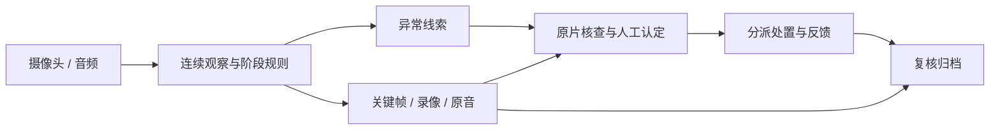

## 从一场监管开始

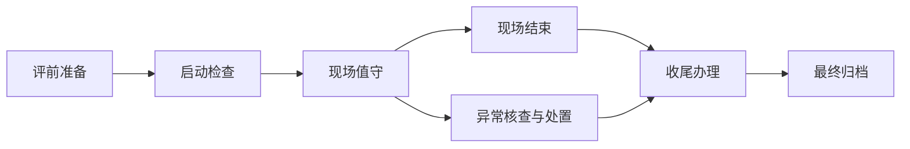

1. **准备配置。** 管理员维护项目、评标室及可复用的机位与区域资源版本，指定默认监测方案。
2. **创建监管场次。** 在“场次管理”选择现场资源版本创建场次，直接进入本场准备；后续资源更新不会覆盖本场。
3. **完成评前检查。** 核对本场范围和必要人工检查；默认基础行为方案不强制工位与门线标定，启用相应能力再检查。需要人员身份核查时再启用并准备核验依据；运行后的画面与分析心跳单独核验。
4. **开展现场值守。** 按已保存方案推进阶段，查看待办和证据，记录巡查及交接。阶段配置保存后仍需关注消费者应用回执。
5. **结束现场。** 结束采集时段后进入收尾办理，继续处理尚未办结的事件。
6. **复核归档。** 未办结事件会阻断最终归档；媒体缺口保留事实并登记说明。晚到事件或证据变化会提示补充归档，保留原有记录。

<details>
<summary>查看告警核查、场次作业与管理中心</summary>

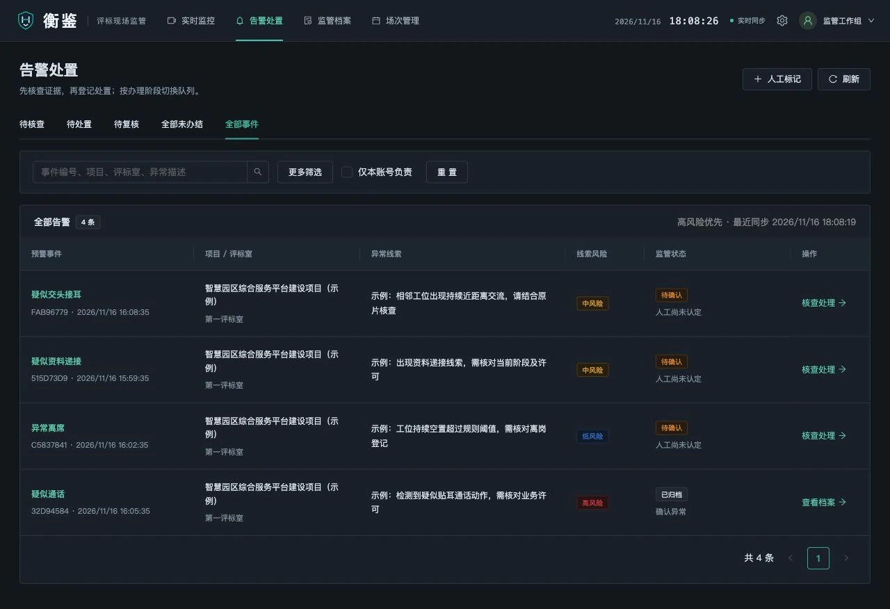

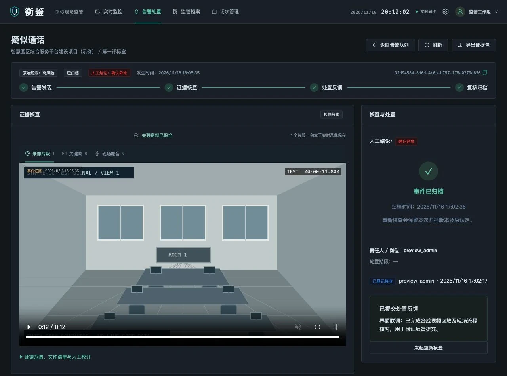

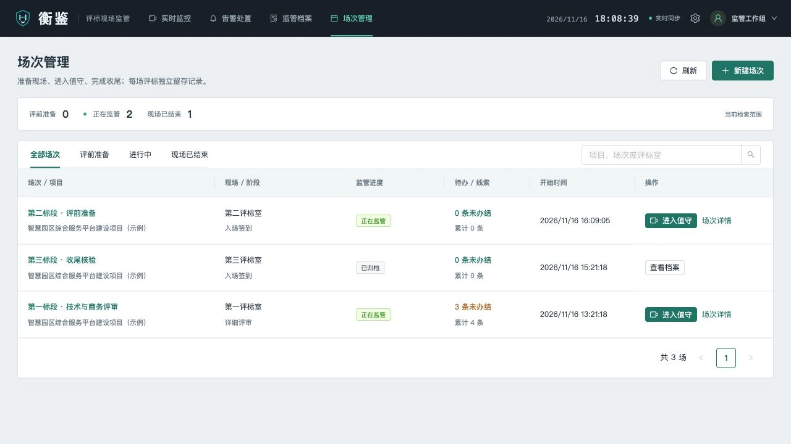

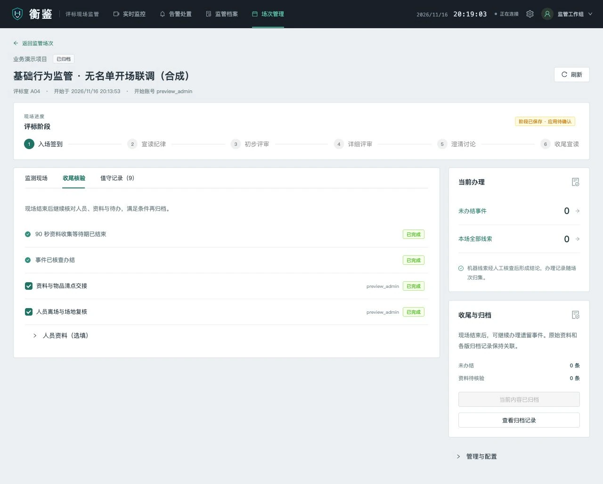

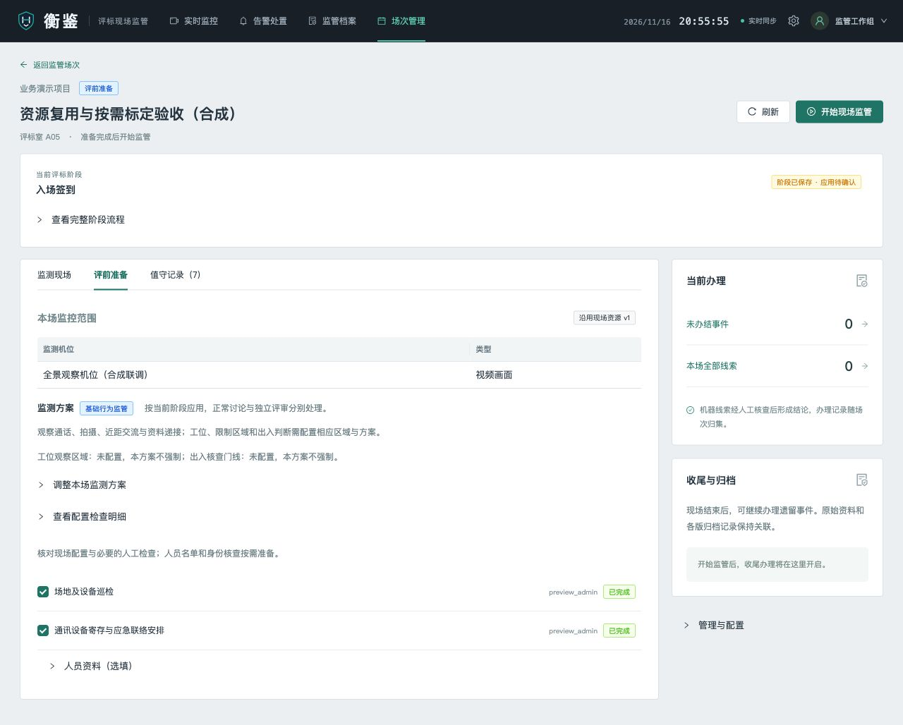

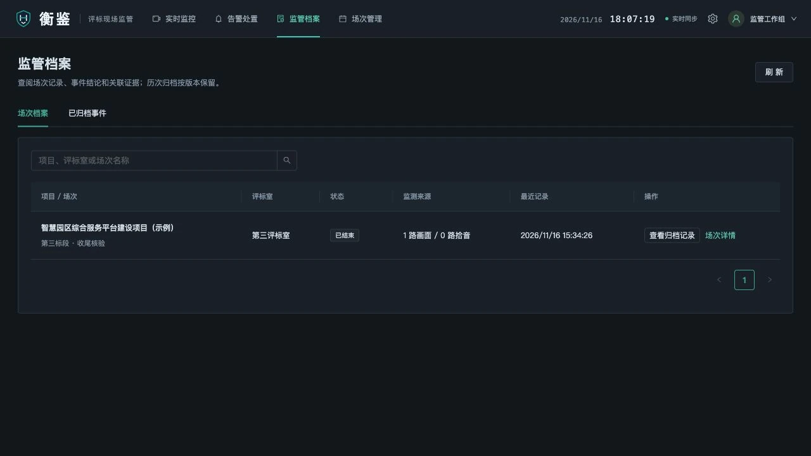

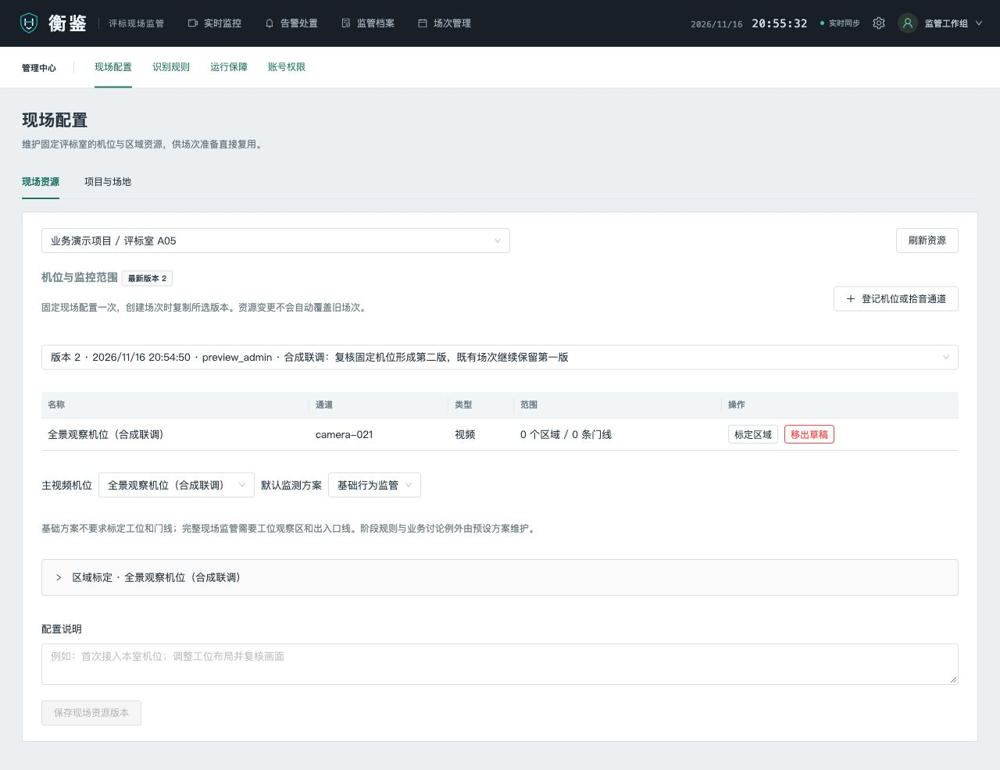

以上为合成资料预览。

</details>

### 现场值守与管理中心

| 入口 | 面向的工作 |
| --- | --- |
| **实时监控** | 打开即进入值守画面，选择机位、切换分屏、查看告警并同屏核查证据 |
| **场次管理** | 检查准备、直接进入值守、查看待办和完成收尾归档 |
| **告警处置** | 查询处置台账、跟进责任任务与反馈，查看完整事件档案 |
| **监管档案** | 查阅场次记录、事件处理和保全证据 |

日常导航只保留这四个入口。管理员从齿轮进入现场配置、识别规则、运行保障和账号权限。人员名单收在场次准备中，默认不要求登记照片、全员核验或确认名单；启用人员身份核查后，才校验相应身份依据。补充音频按需从事件补证打开。监管档案默认展示正式归档记录，导出集中为监管报告与事件证据包。

各页面共用顶部导航、状态与操作样式。告警核查和归档沿用值守台的深色工作区；场次和管理表单采用同一套紧凑布局。页面显示和服务端角色权限共同控制可操作范围。

## 开始使用

### 1. 获取项目并初始化配置

准备 Git、Python 3.11+（用于初始化配置）、已运行的 Docker 和 Docker Compose v2。基础业务服务可以先独立启动，视觉和语音服务在准备好设备、模型及素材后接入。

```bash
git clone https://github.com/fuyuxiang/ibess.git
cd ibess
python3 scripts/init_env.py
```

初始化脚本生成本机 `.env` 和随机基础设施口令。首次打开页面时创建管理员账号。已有部署保留原配置和凭据，升级步骤见 [数据库迁移](docs/architecture/database.md)。

### 2. 启动业务平台

全新安装使用 Linux 覆盖文件创建持久化卷，不依赖历史演示环境的外部卷：

```bash
docker compose -f docker-compose.yml -f deploy/linux/docker-compose.linux.yml config --quiet

docker compose -f docker-compose.yml -f deploy/linux/docker-compose.linux.yml up -d --build \
  postgres redis minio mediamtx api event-service media-service web-console
```

打开 **http://localhost:3000** 完成账号初始化。此时可以管理业务资料、配置场次和使用处置工作台；实时画面和自动识别需要继续接入设备与模型。

新场次建立后，由部署人员运行 `python3 scripts/configure_phase_consumer.py --session-id <场次UUID>`，将本场全部启用通道的准确范围登记到本机授权文件；命令和应用回执核验步骤见 [场次使用与部署接入](docs/session-workflow.md)。

### 3. 接入现场识别

在本机 `.env` 填写获准使用的 `RTSP_URL`，以及视觉和语义模型配置。连续画面复核要求服务支持多图输入：

```dotenv
RTSP_URL=
YOLO_MODEL=/assets/yolov8n.pt
VISUAL_MODEL_BASE_URL=
VISUAL_MODEL_NAME=
VISUAL_MODEL_API_KEY=
SEMANTIC_MODEL_BASE_URL=
SEMANTIC_MODEL_NAME=
SEMANTIC_MODEL_API_KEY=
```

准备本地检测权重和语音模型缓存，再构建当前推理基线：

```bash
python3 scripts/fetch_face_models.py
docker build -f deploy/inference-base/Dockerfile -t poc-inference-base:latest .
```

当前 Compose 将仓库外的 `../dev_assets` 挂载为 `/assets`，将 `../models_cache` 用于语音模型缓存。YOLO 权重、语音模型和原始素材不随源码分发；按实际安装位置配置挂载和模型路径后启动所需消费者：

```bash
docker compose -f docker-compose.yml -f deploy/linux/docker-compose.linux.yml up -d --build \
  vision-worker audio-worker semantic-worker
```

视觉/语音服务当前复用 CUDA 12.8 推理镜像。硬件加速方式、模型资源、额外机位和既有数据迁移参见 [部署说明](deploy/linux/README.md)。不要以容器启动成功代替画面、模型及证据链路验收。

## 技术架构

前端使用 React、TypeScript 和 Ant Design；API 使用 FastAPI。视觉、音频、语义、事件、媒体与离线质检分别运行，通过 Redis Streams、PostgreSQL 和对象存储协作。

```text
web-console/              业务工作台与管理中心
services/                 API、识别消费者、事件处理及媒体服务
packages/ibess-common/     公共消息契约、规则参数与持久化映射
requirements/             依赖约束与开发锁文件
tests/                    契约及架构边界测试
tools/check.py            本地与 CI 统一检查入口
docs/                     产品、架构、迁移及开发说明
```

数据库结构由 API 的版本迁移统一管理；消费者复用公共契约并检查所需结构。现有仓库名 `ibess` 和部署标识保留，品牌调整不会要求迁移既有数据卷。

## 文档

| 我想做什么 | 从这里开始 |
| --- | --- |
| 场次准备、临时许可与收尾归档 | [场次使用](docs/session-workflow.md) |
| 查看本轮检查范围与结果 | [改造验证](docs/product-validation.md) |
| 了解产品设计与参考依据 | [产品说明](docs/product-reference.md) |
| 在本地开发、运行测试 | [开发与交付](docs/development.md) |
| 了解服务边界和目录组织 | [架构说明](docs/architecture/README.md) |
| 升级已有数据库 | [迁移与数据归属](docs/architecture/database.md) |
| 接入消息与规则 | [公共协议](docs/contracts/README.md) |
| 部署到 Linux 服务器 | [部署指南](deploy/linux/README.md) |
| 接入可选控制器与离线质检 | [可选组件](deploy/integration/README.md) |

## 开发与参与

```bash
make bootstrap
cd web-console && npm ci && cd ..
make test
make web
```

完整集成检查使用显式指定的专用 PostgreSQL / Redis 环境，步骤见 [开发与交付](docs/development.md)。现场机位的识别效果需要使用实际正负样本验收；代码测试或空室接口调用不代表现场准确率。

欢迎通过 [Issues](https://github.com/fuyuxiang/ibess/issues) 提交可复现问题或场景建议。请说明使用版本、部署方式、复现步骤和预期结果；涉及现场资料时，提供脱敏描述或合成样本。
